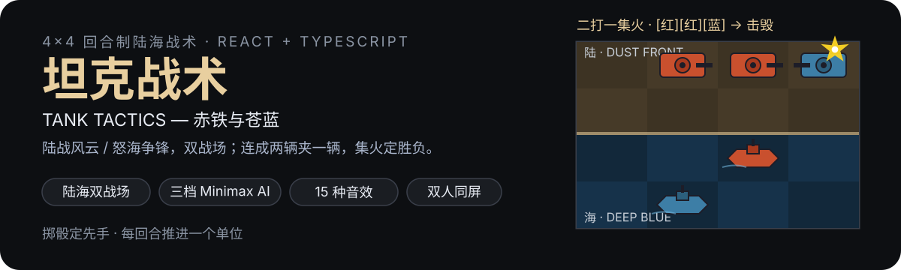
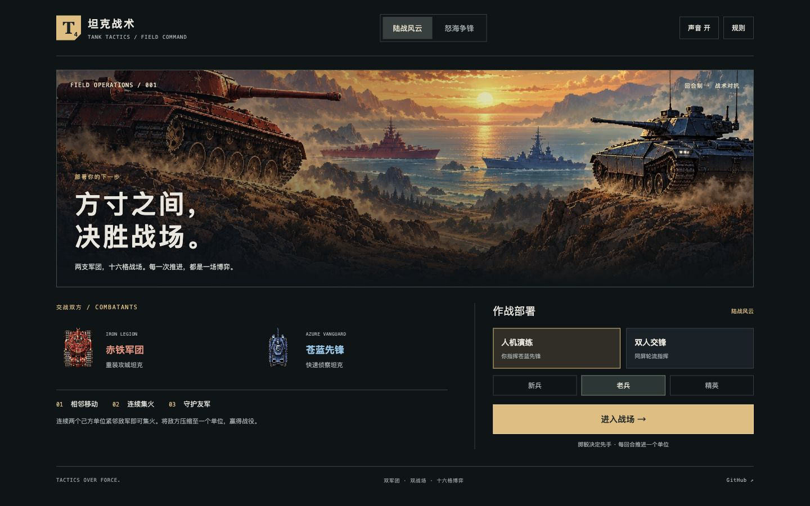
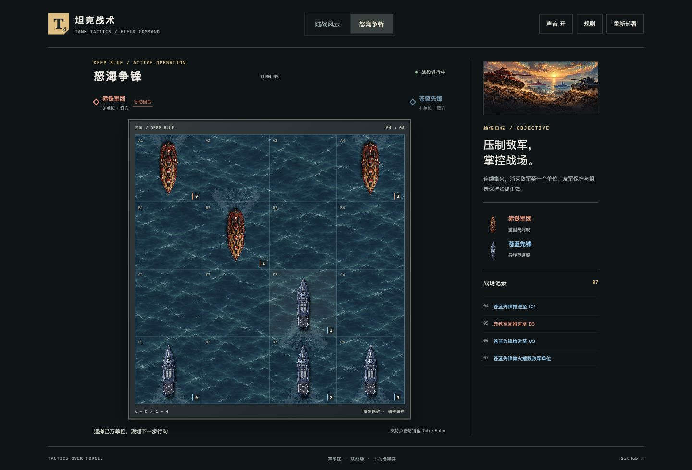

<p align="right"><a href="README.md">中文</a></p>

<p align="center">
  
</p>

<p align="center">
  <a href="https://tank-tactics-game.xiaosang.cc/">▶ Play Online</a>
  ·
  <a href="https://github.com/holynova/tank-tactics-game">GitHub Repository</a>
</p>

Tank Tactics is a 4×4 turn-based land-and-sea tactics game: the 赤铁军团 Iron Legion and the 苍蓝先锋 Azure Vanguard take turns advancing on a sixteen-cell board; two consecutive friendly units next to an enemy destroy it. Reduce the enemy to one unit to win. Two theaters — tanks on land, warships at sea — each with its own terrain, illustrations and sound. Local PvP and AI practice. React + TypeScript.

## Screenshots

<p align="center">
  
  
</p>

## How to Play

- **Opening dice roll**: a dice roll decides who moves first; each turn, advance one unit.
- **Move**: tap one of your units, then tap an orthogonally adjacent empty cell; no diagonal moves, jumps, or occupied cells.
- **Focus fire**: after landing, the unit's row and column are scanned. Three consecutive cells reading `[me][me][foe]` or `[foe][me][me]` destroy the outermost enemy; rows and columns resolve independently.
  - **Crowding protection**: a line with more than 3 units does not resolve at all.
  - **Friendly cover**: a threatened enemy adjacent to a friendly unit of the same color is spared.
- **Winning**: a side reduced to a single unit loses.

## Modes & Content

- **Two theaters**: 陆战风云 Dust Front (tanks) and 怒海争锋 Deep Blue (warships), switchable any time; each faction has distinct unit art — the Iron Legion fields heavy siege tanks / battleships, the Azure Vanguard fast recon tanks / missile destroyers.
- **AI practice**: you command Blue, the computer plays Red; three Minimax difficulties — 新兵 Recruit (depth 1), 老兵 Veteran (depth 2), 精英 Elite (depth 3) — with alpha-beta pruning.
- **2-player duel**: take turns commanding Red and Blue on the same screen.
- **Presentation**: rolling tracks, dust, ship wakes, artillery lighting and illustrated results; 15 original sound effects (engines, gunfire, explosions, ambience), mutable.
- **Battle log**: every move is recorded, so the whole game can be reviewed.

## Run Locally

Node.js + pnpm:

```bash
pnpm install --frozen-lockfile
pnpm dev
```

```bash
pnpm typecheck
pnpm lint
pnpm test      # node --test, 10 cases, all passing
pnpm build
```

## Tech

- React 18 + TypeScript + Vite 4 + Tailwind CSS 3; the rules engine is pure functions (`src/rules/`: movement / focus fire / win-loss), separated from rendering.
- The AI is Minimax with alpha-beta pruning (`src/hooks/useBotAI.ts`), evaluating material, central control and danger avoidance.
- Art is AI-drawn raster assets (`public/art/`, WebP); original PNGs and prompts are kept in `source-art/`; raw audio samples in `source-audio/`, processing scripts in `scripts/`.

```
src/App.tsx             Main flow: lobby / dice roll / battle / results
src/components/         Board / status bar / battle log / rules modal / result illustrations
src/rules/              Movement / focus fire / win-loss (pure functions)
src/hooks/useBotAI.ts   Minimax AI (three depths)
src/utils/soundEngine.ts  Playback and lifecycle of 15 sound effects
public/art/             Terrain / units / effects / scene illustrations (WebP)
public/audio/           15 original sound effects (ogg + wav)
```
