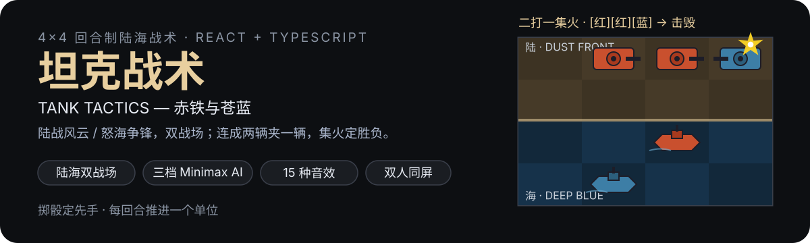
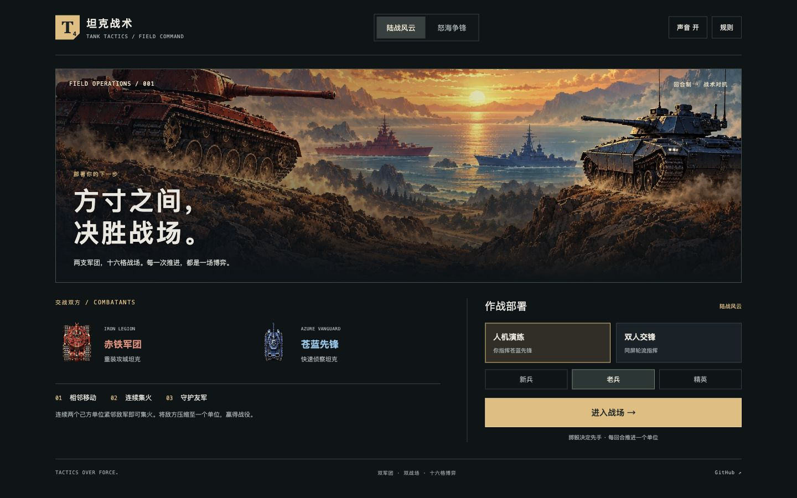
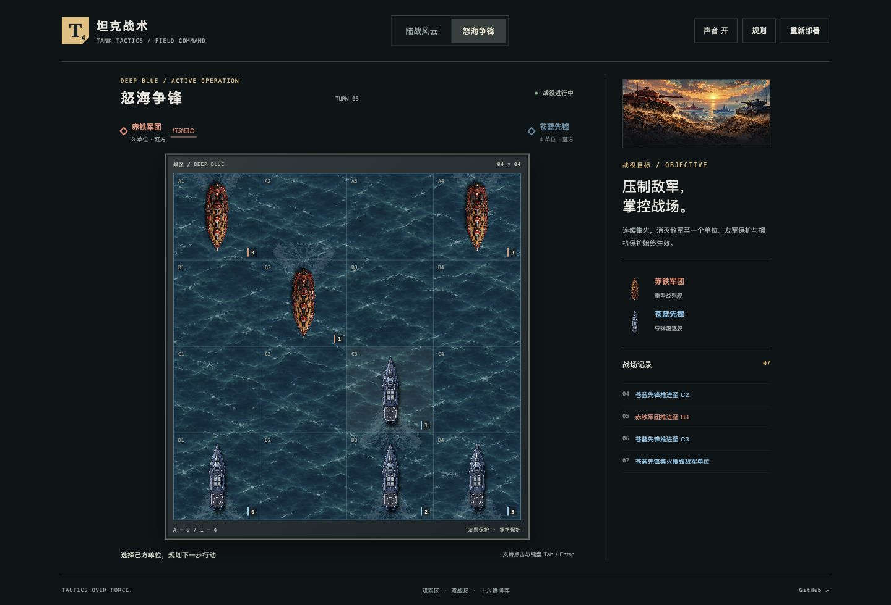

<p align="right"><a href="README.en.md">English</a></p>

<p align="center">
  
</p>

<p align="center">
  <a href="https://tank-tactics-game.xiaosang.cc/">▶ 在线玩</a>
  ·
  <a href="https://github.com/holynova/tank-tactics-game">GitHub 仓库</a>
</p>

坦克战术是一款 4×4 回合制陆海战术游戏：赤铁军团与苍蓝先锋在十六格战场上轮流推进，连续两个己方单位邻接敌军即可集火，将敌方压缩至一个单位即获胜。陆海双战场——陆上是坦克、海上是舰船，各有专属地形、插画与音效；支持同屏双人与人机演练。React + TypeScript。

## 截图

<p align="center">
  
  
</p>

## 玩法

- **先手掷骰**：开局掷骰决定先手；每回合推进一个单位。
- **移动**：点选己方单位，再点上下左右正交相邻的空格；不能斜走、跳跃或进入占用格。
- **连续集火**：落点后扫描所在行与列。连续三格出现 `[我][我][敌]` 或 `[敌][我][我]`，最外侧的敌军即被击毁；行列独立结算。
  - **拥挤保护**：某条线上超过 3 个单位时，整条线不结算。
  - **守护友军**：受威胁的敌军紧邻同色友军时，免于被歼灭。
- **胜负**：任一方只剩 1 个单位时判负。

## 模式与内容

- **双战场**：陆战风云（DUST FRONT，坦克）与怒海争锋（DEEP BLUE，舰船），可随时切换；两军团造型独立——赤铁军团是重装攻城坦克 / 重型战列舰，苍蓝先锋是快速侦察坦克 / 导弹驱逐舰。
- **人机演练**：你指挥蓝方，电脑执红方；三档 Minimax AI——新兵（1 层搜索）、老兵（2 层）、精英（3 层），带 Alpha-Beta 剪枝。
- **双人交锋**：同屏轮流指挥红蓝双方。
- **表现**：履带滚动、扬尘、舰船尾流、炮弹光影与胜负插画；15 种原创音效（引擎、炮火、爆炸、环境声等），可开关。
- **战场记录**：每步行动记入战报，可回顾整局进程。

## 本地运行

Node.js + pnpm：

```bash
pnpm install --frozen-lockfile
pnpm dev
```

```bash
pnpm typecheck
pnpm lint
pnpm test      # node --test，10 个用例全过
pnpm build
```

## 技术

- React 18 + TypeScript + Vite 4 + Tailwind CSS 3；规则引擎是纯函数（`src/rules/`：移动 / 集火 / 胜负），与渲染层分离。
- AI 是带 Alpha-Beta 剪枝的 Minimax（`src/hooks/useBotAI.ts`），评估含子力、中央控制与危险规避。
- 美术为 AI 绘制的光栅素材（`public/art/`，WebP），原始 PNG 与提示词保留在 `source-art/`；音效原始采样在 `source-audio/`，处理脚本见 `scripts/`。

```
src/App.tsx             主流程：大厅 / 掷骰 / 对战 / 结算
src/components/         棋盘 / 状态栏 / 战报 / 规则弹窗 / 结算插画
src/rules/              移动 / 集火 / 胜负判定（纯函数）
src/hooks/useBotAI.ts   Minimax AI（三档深度）
src/utils/soundEngine.ts  15 种音效的播放与生命周期
public/art/             地形 / 单位 / 特效 / 场景插画（WebP）
public/audio/           15 种原创音效（ogg + wav）
```
